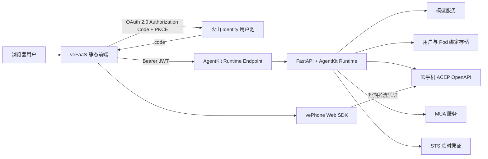
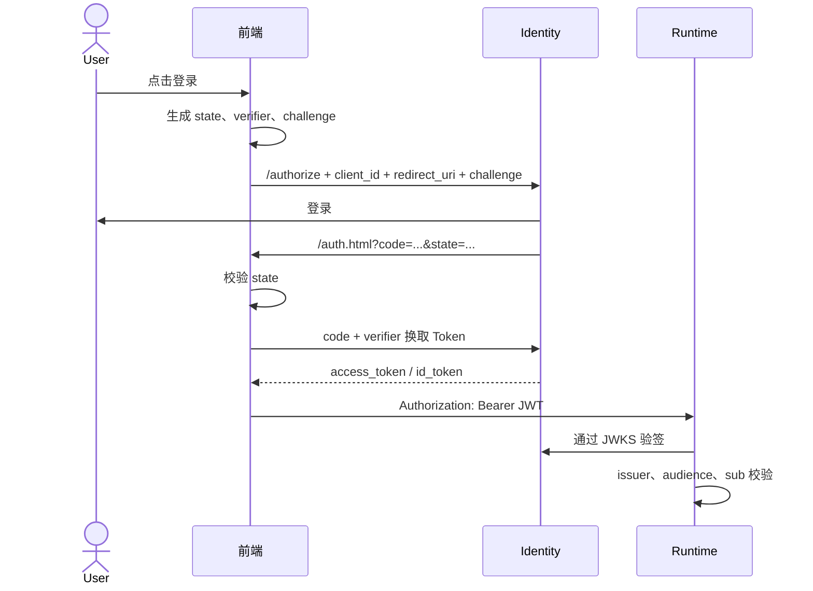
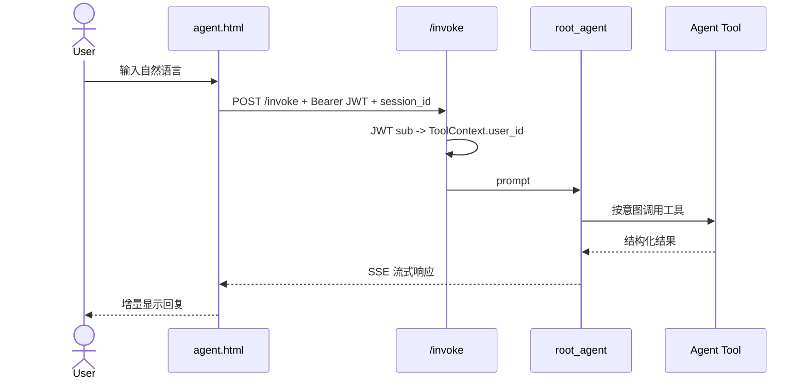
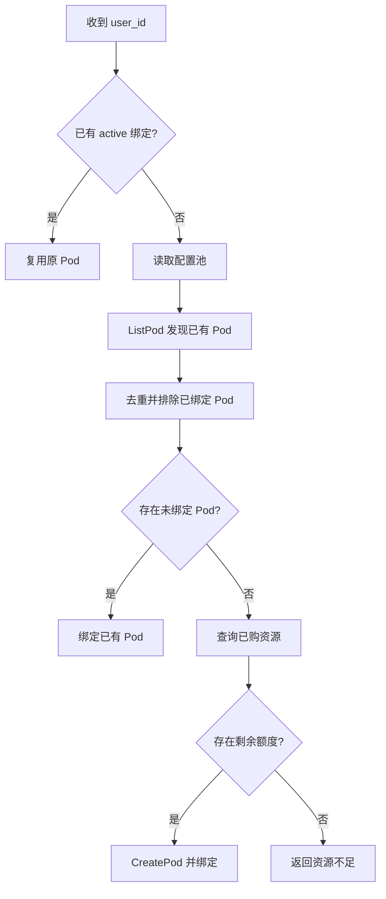
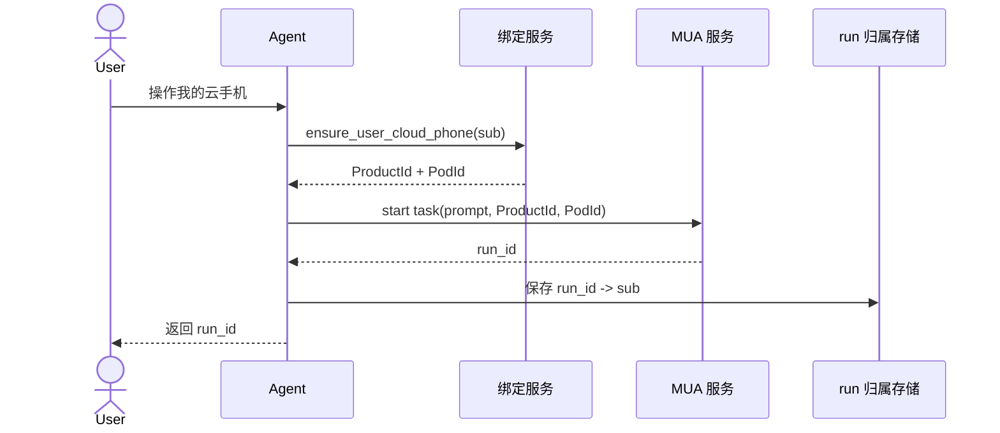
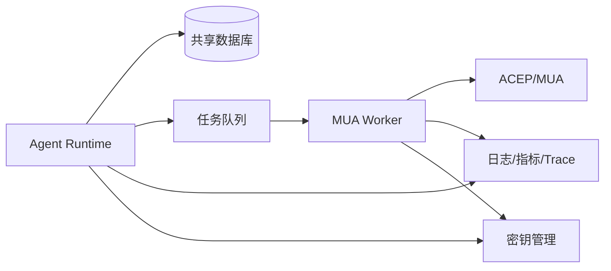

# Work Life Agent 方案与架构设计

## 1. 文档目的

本文描述 Work Life Agent 从 Web 登录、Agent 对话、用户身份隔离、云手机分配、MUA 任务执行到 Web 拉流的完整方案。文档同时说明：

- 当前已经实现的架构与代码边界。
- 关键业务流程和安全约束。
- veFaaS、APIG、AgentKit Runtime、Identity 和云手机之间的关系。
- 当前实现的限制、已知风险和生产化演进方向。
- 部署、验收、排障和回滚方法。

本文不记录 AK/SK、模型密钥、用户 Token、真实用户绑定或其他敏感信息。

## 2. 建设目标

Work Life Agent 面向登录用户提供两类能力：

1. 个人工作生活管理
   - 待办记录、查询和完成。
   - 饮食打卡。
   - 睡眠记录。
   - 每日汇总。
2. 用户专属云手机
   - 为每个 Identity 用户绑定一台云手机。
   - Agent 只能操作当前登录用户绑定的云手机。
   - 支持自然语言发起 MUA 自动化任务。
   - 支持任务查询、取消和运行归属校验。
   - 支持浏览器内实时拉流和交互。

核心约束：

- 用户身份唯一来源是经过校验的 Identity JWT `sub`。
- 浏览器传入的 `user_id`、`ProductId` 和 `PodId` 不直接作为授权依据；用户明确请求切换 Pod 时，目标 `PodId` 仍须由服务端验证。
- 已有云手机优先分配，全部占用后才允许创建新 Pod。
- 不向普通 Agent 暴露其他用户、Pod 池或未经验证的 Pod 绑定能力。
- 创建资源、支付、下单等高影响动作必须受控。

## 3. 系统全景



## 4. 部署拓扑

### 4.1 前端

- 运行位置：veFaaS。
- 暴露方式：APIG 默认域名。
- Runtime：Python 3.12。
- 启动命令：`python static_server.py`。
- 监听端口：`8000`。
- 页面：
  - `index.html`：登录、注册和入口。
  - `auth.html`：OAuth 回调与换取 Token。
  - `agent.html`：Agent 对话。
  - `stream.html`：云手机拉流。
  - `config.js`：当前部署的公开配置，不包含秘密。
- 服务端辅助路由：
  - `GET /oauth/signup`：建立 Identity 授权事务后跳转注册页。

### 4.2 Agent Runtime

- 运行位置：AgentKit Cloud Runtime。
- 网络模式：公网 Endpoint。
- 鉴权模式：`custom_jwt`。
- 应用入口：`main.py`。
- Web 框架：FastAPI。
- Agent 服务：`AgentkitAgentServerApp`。
- Runtime 负责：
  - JWT 二次验签和用户身份解析。
  - Agent 调用和 SSE 输出。
  - 用户到云手机的分配。
  - MUA 任务编排。
  - Web 拉流临时凭证签发。

### 4.3 外部依赖

- 火山 Identity：用户池、SPA 客户端、OIDC Discovery、JWKS。
- 模型服务：兼容项目所配置的 AgentKit/VEADK 模型接口。
- ACEP 云手机 OpenAPI：Pod 查询、创建、启动、拉流等。
- MUA 服务：自然语言云手机自动化任务。
- STS：签发短期、最小权限的拉流凭证。

## 5. 代码模块

| 模块 | 职责 |
| --- | --- |
| `main.py` | FastAPI 路由、CORS、JWT 用户注入、AgentKit 挂载 |
| `auth.py` | Identity JWT 验签、issuer/audience 校验、提取 `sub` |
| `assistant/agent.py` | Agent 定义、系统指令和工具注册 |
| `assistant/tools.py` | 生活记录、云手机分配、MUA 和拉流工具 |
| `assistant/user_registry.py` | 用户-Pod 绑定、Pod 分配、run 归属 |
| `assistant/cloud_phone/client.py` | ACEP、MUA、STS 的底层 SDK/OpenAPI 客户端 |
| `frontend/index.html` | OAuth/PKCE 登录与注册入口 |
| `frontend/auth.html` | code 换 Token、保存会话、进入 Agent |
| `frontend/agent.html` | SSE 对话和拉流页面入口 |
| `frontend/stream.html` | vePhone Web SDK 拉流 |
| `frontend/static_server.py` | 静态服务、禁缓存、注册桥接 |
| `scripts/deploy_vefaas_fast.py` | 使用火山 Python SDK 部署前端和 APIG |

## 6. 身份认证与授权

### 6.1 登录协议

前端使用 OAuth 2.0 Authorization Code Flow + PKCE：



### 6.2 注册流程

Identity 注册页要求有效的 `authRequestId`。不能直接访问裸注册回调地址。

当前实现：

1. 前端先构造标准 `/authorize` 请求。
2. 前端请求同源 `/oauth/signup`。
3. `static_server.py` 请求 Identity `/authorize`，但不自动跟随跳转。
4. 校验 Identity 返回的 `/login?authRequestId=...`。
5. 将同一授权事务转换成 `/signup?authRequestId=...`。
6. 注册完成后继续原 OAuth 回调。

安全措施：

- 只允许 HTTPS。
- Identity 主机必须匹配用户池域名规则。
- 请求路径只能是 `/authorize`。
- 返回域名必须与请求域名一致。
- 返回路径和 `authRequestId` 必须有效。

### 6.3 Runtime 双层鉴权

Runtime 使用两层校验：

1. AgentKit Runtime 网关通过 OIDC Discovery 和 allowed client 校验 JWT。
2. `auth.py` 使用 JWKS 再次校验签名、issuer 和 audience。

`main.py` 在 `/invoke` 请求进入 AgentKit 前，将经过验证的 JWT `sub` 写入内部 `user_id` 请求头，使 `ToolContext.user_id` 与登录身份一致。

### 6.4 Token 生命周期

前端保存：

- `accessToken`
- `idToken`
- `expiresIn`
- `expiresAt`
- `userId`

当前没有实现 refresh token 自动刷新。Token 过期或 Runtime 返回 401 时，应清理本地认证状态并重新登录。

## 7. Agent 对话流程



Agent 当前工具分为：

- 生活管理：待办、饮食、睡眠、每日汇总。
- 云手机：查询当前绑定、切换到用户明确指定的 Pod、启动任务、查询任务、取消任务。

Agent 指令禁止：

- 枚举 Pod 池。
- 查看其他用户绑定。
- 接受用户指定的 `ProductId`，或在未验证情况下修改 `PodId` 绑定。
- 用户明确要求切换并提供完整 `PodId` 时，可以调用切换工具；不得主动枚举可选 Pod。
- 未经明确要求执行支付、下单、发消息等高影响操作。

## 8. 云手机分配设计

### 8.1 分配目标

对稳定 Identity `sub` 实现一用户一台云手机：

```text
Identity sub -> ProductId + PodId + status
```

### 8.2 当前分配顺序

`allocate_user_binding()` 在文件锁内执行：

1. 检查当前用户是否已有 `active` 绑定。
2. 有绑定则直接复用，不查询或创建资源。
3. 读取管理员配置的 `pod_pool.json`。
4. 调用 `ListPod` 发现当前 Product 下已有 Pod。
5. 合并配置池和发现结果，并按 PodId 去重。
6. 汇总所有活跃绑定使用的 Pod。
7. 从候选池中选择第一个未绑定 Pod。
8. 没有未绑定 Pod 时才调用 `CreatePod`。
9. 原子写入用户绑定。



重要规则：

- `ListPod` 失败时不允许继续 `CreatePod`，避免因查询故障重复购买。
- 管理员配置池优先于自动发现结果。
- 已购资源的 `ApplyNum - TotalNum` 表示还能创建多少 Pod，不表示还有多少 Pod 未绑定。
- 绑定已有 Pod 与创建新 Pod 是两个不同动作。

### 8.3 规格选择

当前规格逻辑只作用于创建新 Pod：

- 已有未绑定 Pod：直接分配，不动态变更规格。
- 需要创建 Pod：查询 `ListPodResource`。
- 未指定规格和机房时，选择剩余额度最多的已购资源。
- 设置 `MUA_CONFIGURATION_CODE` 或 `MUA_CREATE_DC` 后，只在指定范围内选择。
- 所有已购规格均无余额时返回错误。
- 当前不支持通过 Agent 对话动态升级、降级或迁移已绑定 Pod。

规格变更属于可能产生费用和停机的操作，未来应使用“查询可选规格 -> 展示影响 -> 用户确认 -> 变更 -> 校验”的独立流程。

### 8.4 用户请求切换 Pod

用户明确要求切换云手机绑定并提供完整 `PodId` 时，主 Agent 可以调用 `switch_my_cloud_phone`。服务端执行以下校验：

1. 用户身份只取当前 JWT `sub`，不接受用户指定其他 `user_id`。
2. 不接受用户指定 `ProductId`，只允许当前配置 Product 下的 Pod。
3. 调用 `ListPod` 确认目标 Pod 真实存在且未归档。
4. 检查目标 Pod 未被其他活跃用户绑定。
5. 在绑定锁内原子替换当前用户绑定。
6. 记录来源为 `UserRequestedPodSwitch`，并返回切换前后的绑定。

若目标就是当前 Pod，则返回幂等成功，不重复写入。用户没有提供 `PodId` 时，Agent 只能询问目标 ID，不得列举资源池。

## 9. MUA 任务流程



查询或取消任务前必须执行 `assert_run_owner(run_id, user_id)`。非当前用户任务统一返回不可用，避免泄漏任务是否存在。

## 10. Web 拉流

### 10.1 拉流凭证

浏览器不持有云账号 AK/SK。流程如下：

1. `stream.html` 携带 Identity Bearer Token 请求 `/api/stream-session`。
2. Runtime 由 JWT `sub` 查找用户绑定。
3. Runtime 生成限定账号、Product 和 Pod 的短期 STS 凭证。
4. 前端将会话参数传给 `@volcengine/vephone` SDK。
5. SDK 建立实时拉流连接。

### 10.2 页面适配

当前云手机页面按竖屏设计：

- 容器宽高比固定为 `9:16`。
- 使用 `ResizeObserver` 根据可用区域等比缩放。
- `videoRenderMode: 0`，使用等比居中模式。
- 桌面和移动端均不横向拉伸画面。
- SDK 版本固定，升级时需要进行真实拉流回归。

### 10.3 错误处理

- 响应先按文本读取，再尝试 JSON 解析。
- 兼容 Runtime 网关返回纯文本错误。
- JWT 失效时清除本地认证状态并返回登录页。
- 页面禁止缓存，避免发布后继续运行旧逻辑。

## 11. HTTP API

| 方法 | 路径 | 用途 | 鉴权 |
| --- | --- | --- | --- |
| `POST` | `/invoke` | Agent SSE 对话 | Bearer JWT |
| `GET` | `/api/me` | 获取用户身份和云手机绑定 | Bearer JWT |
| `GET` | `/api/stream-session` | 获取 Web 拉流会话 | Bearer JWT |
| `POST` | `/api/mua/stream-token` | 获取兼容拉流凭证 | Bearer JWT |
| `POST` | `/api/mua/task` | 启动 MUA 任务 | Bearer JWT |
| `GET` | `/api/mua/task/{run_id}` | 查询当前用户任务 | Bearer JWT + owner |
| `POST` | `/api/mua/provision` | 显式创建并绑定 Pod | Bearer JWT |

注意：当前 `/api/me` 会调用 `ensure_user_cloud_phone()`，因此查询可能触发分配，极端情况下还可能创建计费资源。生产设计应将“查询”和“分配/创建”拆开。

## 12. 数据模型

### 12.1 用户绑定

```json
{
  "<identity-sub>": {
    "product_id": "<product-id>",
    "pod_id": "<pod-id>",
    "status": "active",
    "allocated_at": "<unix-time>",
    "source": "PodPool | ListPod | CreatePod | UserRequestedPodSwitch"
  }
}
```

约束：

- 一个活跃用户最多一个活跃 Pod。
- 一个 Pod 最多绑定一个活跃用户。
- 绑定状态至少包括 `active`、`released` 和 `disabled`。

### 12.2 MUA run 归属

```json
{
  "<run-id>": {
    "user_id": "<identity-sub>",
    "created_at": "<unix-time>"
  }
}
```

### 12.3 生活记录

当前 `data/work_log.json` 保存：

- `todos`
- `meals`
- `sleep`

当前生活记录没有按用户分区，是生产化前必须修复的数据隔离问题。

## 13. 配置设计

### 13.1 Runtime 必需配置

| 配置 | 说明 |
| --- | --- |
| `MODEL_AGENT_NAME` | Agent 使用的模型 |
| `MODEL_AGENT_PROVIDER` | 模型 Provider |
| `MODEL_AGENT_API_BASE` | 模型服务地址 |
| `MODEL_AGENT_API_KEY` | 模型密钥 |
| `VOLCENGINE_ACCESS_KEY` | 火山 OpenAPI AK |
| `VOLCENGINE_SECRET_KEY` | 火山 OpenAPI SK |
| `MUA_PRODUCT_ID` | 云手机 Product |
| `MUA_ACCOUNT_ID` | 云手机所属账号 |
| `OIDC_USER_POOL_ID` | Identity 用户池 |
| `OIDC_REGION` | Identity 区域 |
| `OIDC_AUDIENCE` | SPA Client ID |
| `CORS_ORIGINS` | 允许访问 Runtime 的前端 Origin |

### 13.2 可选配置

| 配置 | 默认值/行为 |
| --- | --- |
| `MUA_CONFIGURATION_CODE` | 空，自动选择已购规格 |
| `MUA_CREATE_DC` | 空，自动选择机房 |
| `MUA_DATA_SIZE` | `4Gi` |
| `MUA_STREAM_TOKEN_TTL_SECONDS` | `600` |
| `USER_POD_BINDINGS_PATH` | 本地绑定 JSON |
| `MUA_POD_POOL_PATH` | 本地 Pod 池 JSON |
| `MUA_RUN_OWNERS_PATH` | 本地 run 归属 JSON |

`USER_POD_BINDINGS_JSON` 是只读预置方式，不适合运行期动态分配。

### 13.3 前端公开配置

`frontend/config.js` 可包含：

- Runtime Endpoint。
- Identity Region。
- User Pool ID。
- SPA Client ID。

这些是公开客户端配置，不能放入 AK/SK、模型 Key 或其他服务端秘密。

## 14. 安全设计

### 14.1 已实现措施

- OAuth Authorization Code + PKCE。
- OAuth `state` 校验。
- Runtime custom JWT。
- 服务端 JWT 签名、issuer、audience 校验。
- 使用 JWT `sub` 作为唯一用户身份。
- MUA run 所有权校验。
- 不接受浏览器指定的授权 Pod。
- 注册桥接防 SSRF 和开放重定向。
- 拉流使用短期凭证，不向浏览器暴露 AK/SK。
- CORS 仅允许配置的前端 Origin。

### 14.2 仍需加强

- AK/SK 和模型 Key 应迁移到密钥管理服务，不应长期保存在 YAML。
- `/api/mua/provision` 应增加管理员权限或明确的计费确认机制。
- STS Policy 应继续缩小到 Web SDK 实际需要的最小 Action。
- 增加请求限流、审计日志和异常行为告警。
- 避免在日志、错误信息和前端 debug 区暴露完整资源信息。
- 增加 CSP、`Referrer-Policy` 和更严格的安全响应头。

## 15. 当前限制与风险

### 15.1 本地 JSON 不是云端持久化

当前以下内容保存在 Runtime 本地文件：

- 用户-Pod 绑定。
- MUA run 归属。
- 生活记录。
- Agent 短期记忆。

风险：

- Runtime 重启、重部署后可能丢失。
- 多副本之间不共享。
- `fcntl` 只能解决单机进程并发，不能解决多实例并发。
- 绑定丢失后，系统可能将逻辑上已分配的 Pod 再次分配。

这是当前最高优先级的生产化问题。

### 15.2 查询接口包含写操作

`GET /api/me` 会确保云手机绑定，可能写入绑定甚至触发创建。该行为不符合 GET 幂等语义，也可能在用户仅打开页面时触发计费操作。

### 15.3 生活记录未按用户隔离

生活记录当前写入同一个 JSON，工具没有使用 `ToolContext.user_id` 分区。多用户使用时可能产生数据混用。

### 15.4 Token 刷新缺失

前端只记录过期时间，未实现静默刷新。过期后需要重新登录。

### 15.5 规格切换缺失

系统可以在新建 Pod 时选择其他已购规格，但不能修改已绑定 Pod 的规格，也没有停机、费用确认和回滚流程。

## 16. 生产化目标架构



建议：

1. 使用共享数据库保存用户、Pod、绑定和 run。
2. 对 `user_id` 和 `pod_id` 建唯一约束。
3. 在事务中使用行锁或原子条件更新完成分配。
4. 将长时间 MUA 任务放入队列，由 Worker 执行。
5. API 只返回任务 ID，前端轮询或订阅状态。
6. 使用密钥管理服务注入 AK/SK 和模型密钥。
7. 使用统一日志、Trace 和指标监控登录、分配、创建、MUA 和拉流。

推荐数据库表：

- `users`
- `cloud_phone_pods`
- `user_pod_bindings`
- `mua_runs`
- `todos`
- `meal_checkins`
- `sleep_records`
- `audit_events`

关键唯一约束：

```text
user_pod_bindings(user_id) WHERE status = 'active' UNIQUE
user_pod_bindings(pod_id)  WHERE status = 'active' UNIQUE
```

## 17. 推荐的资源分配事务

生产环境应在一个数据库事务内执行：

```text
1. SELECT active binding WHERE user_id = ?
2. 有结果则返回。
3. SELECT one available pod FOR UPDATE SKIP LOCKED
4. 原子更新 pod 状态 available -> allocated。
5. 插入 active binding。
6. 提交事务。
7. 没有可用 Pod 时创建异步扩容任务，而不是在 GET 请求中创建。
```

创建完成后再由扩容任务登记 Pod，并重新触发待分配请求。

## 18. 部署流程

### 18.1 前端

1. 配置 `frontend/config.js` 的公开参数。
2. 执行 SDK 直连部署脚本：

   ```bash
   source ../.venv/bin/activate
   python scripts/deploy_vefaas_fast.py
   ```

3. 等待 veFaaS Revision 稳定。
4. 检查 APIG Route、Service、Upstream 和 Function。
5. 验证页面响应包含 `Cache-Control: no-store`。

### 18.2 Runtime

1. 从 `agentkit.example.yaml` 生成私有 `agentkit.yaml`。
2. 填写 Runtime 环境变量。
3. 配置：
   - `runtime_auth_type: custom_jwt`
   - `runtime_jwt_discovery_url`
   - `runtime_jwt_allowed_clients`
4. 执行：

   ```bash
   source ../.venv/bin/activate
   agentkit launch --config-file agentkit.yaml
   ```

5. 将 Runtime Endpoint 配置到前端。
6. 将前端 Origin 配置到 Runtime `CORS_ORIGINS`。

### 18.3 Identity

SPA 客户端至少配置：

```text
https://<frontend-domain>/auth.html
```

Issuer 格式：

```text
https://userpool-<user-pool-id>.userpool.auth.id.<region>.volces.com
```

## 19. 验收清单

### 19.1 身份

- 注册页包含有效 `authRequestId`。
- 登录使用 PKCE。
- OAuth state 校验生效。
- 回调地址完全匹配。
- 无 Token、错误 Token、过期 Token 均被拒绝。
- 用户 A 不能使用用户 B 的绑定或 run_id。

### 19.2 Agent

- 对话 SSE 正常。
- 待办、饮食、睡眠工具实际落库。
- 工具返回结果与 Agent 文案一致。
- Runtime Endpoint 不会回退到浏览器本机地址。

### 19.3 云手机

- 已有绑定优先复用。
- 未绑定已有 Pod 优先于 CreatePod。
- `ListPod` 失败时不创建资源。
- 所有已有 Pod 都已绑定后才允许扩容。
- 资源不足时返回可理解错误。
- 用户明确指定的目标 Pod 存在且未绑定时可以切换。
- 已被其他用户绑定或不属于当前 Product 的 Pod 必须拒绝切换。
- MUA 查询和取消校验 run 所有权。

### 19.4 拉流

- 浏览器不包含 AK/SK。
- 拉流 Token 短期有效。
- 页面以 `9:16` 竖屏显示。
- 桌面、移动端不拉伸、不溢出。
- JWT 失效后返回登录页。
- SDK 加载失败、会话失败和拉流失败均显示可读错误。

## 20. 已解决问题复盘

### 20.1 注册流程与登录流程不一致

原因：注册按钮直接访问裸注册地址，缺少 OAuth 授权事务和 `authRequestId`。

修复：登录和注册共用 Authorization Code + PKCE；注册通过同源桥接进入同一授权事务。

### 20.2 APIG 重复创建 Service

原因：部署脚本使用错误字段查找已有 Service，导致已有资源被误判为不存在。

修复：按 APIG 实际返回字段识别并复用 Service，避免 `409 DuplicatedResource`。

### 20.3 已购 Pod 无法分配

原因：早期逻辑只读取空的本地 Pod 池，没有通过 `ListPod` 发现账号下已有 Pod，随后错误尝试创建新 Pod。

修复：新增云端 Pod 发现；排除已绑定 Pod；只有没有未绑定 Pod 时才调用 `CreatePod`。

### 20.4 拉流页面横屏

原因：SDK 配置为 portrait，但 DOM 容器被设置为全宽全高，桌面端容器本身是横屏。

修复：容器固定 `9:16`，按可用区域等比缩放，并显式使用等比渲染模式。

### 20.5 前端请求错误 Endpoint

原因：前端根地址没有生产默认配置时回退到 `127.0.0.1`。

修复：将非敏感部署参数写入 `config.js`，查询参数仍可覆盖。

### 20.6 JWT 纯文本错误被当作 JSON

原因：拉流接口错误响应直接调用 `response.json()`。

修复：先读取文本，再尝试 JSON；401 时清理旧认证状态并要求重新登录。

## 21. 演进优先级

### P0

- 将绑定、run 归属和生活记录迁移到共享数据库。
- 为用户绑定和 Pod 绑定增加唯一约束。
- 将生活工具按 `ToolContext.user_id` 隔离。
- 将 `/api/me` 改为纯查询，拆出显式分配接口。

### P1

- 增加 refresh token 或可靠的重新认证策略。
- 为创建 Pod 增加额度、费用和权限确认。
- 增加审计日志、监控和告警。
- 增加端到端测试：登录、分配、MUA、拉流。

### P2

- 增加规格升级/降级工作流。
- 增加 Pod 回收、解绑和再分配策略。
- 增加异步任务队列和弹性 Worker。
- 增加管理员资源池和用户绑定管理页面。

## 22. 运维排障顺序

遇到前端错误时按以下顺序检查：

1. 浏览器地址中的 Runtime Endpoint 是否正确。
2. `config.js` 是否为当前部署配置。
3. Token 是否过期，JWT 的 issuer/audience 是否匹配。
4. Runtime `OPTIONS` 是否返回正确 CORS Header。
5. Runtime 是否 Ready。
6. `/api/me` 是否能够解析当前 JWT `sub`。
7. 用户绑定是否存在。
8. `ListPod` 是否返回已有 Pod。
9. 已购资源是否还有创建余额。
10. 拉流 STS Policy 和 Token 是否有效。
11. vePhone SDK 版本和画面容器尺寸是否正确。

错误分类：

- `Failed to fetch`：优先检查 Endpoint、CORS、HTTPS 和网络。
- `401/JWT authentication failed`：检查 Token、issuer、audience 和过期时间。
- `no available purchased cloud-phone resource`：区分“没有未绑定 Pod”和“没有创建额度”。
- `409 DuplicatedResource`：检查部署脚本是否正确复用 APIG 资源。
- 注册页流程异常：检查 `authRequestId` 和 SPA 回调地址。

## 23. 结论

当前方案已经打通完整业务闭环：

```text
Identity 注册/登录
-> AgentKit 鉴权
-> Agent 对话
-> 当前用户云手机分配
-> MUA 操作
-> Web 竖屏拉流
```

当前实现适合单实例验证和功能演示。进入正式多用户生产环境前，必须优先完成共享持久化、严格的数据隔离、计费操作确认和多实例并发控制。
